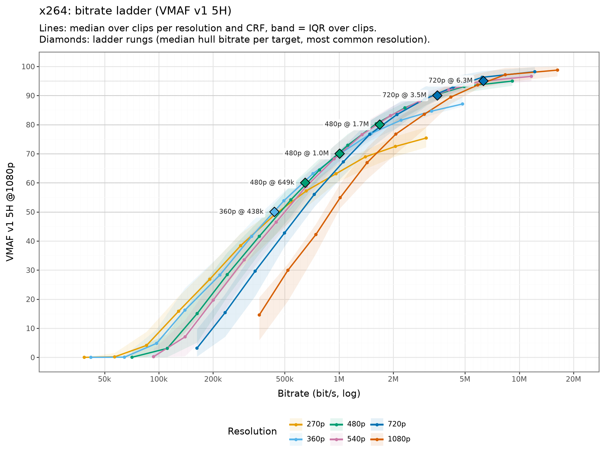
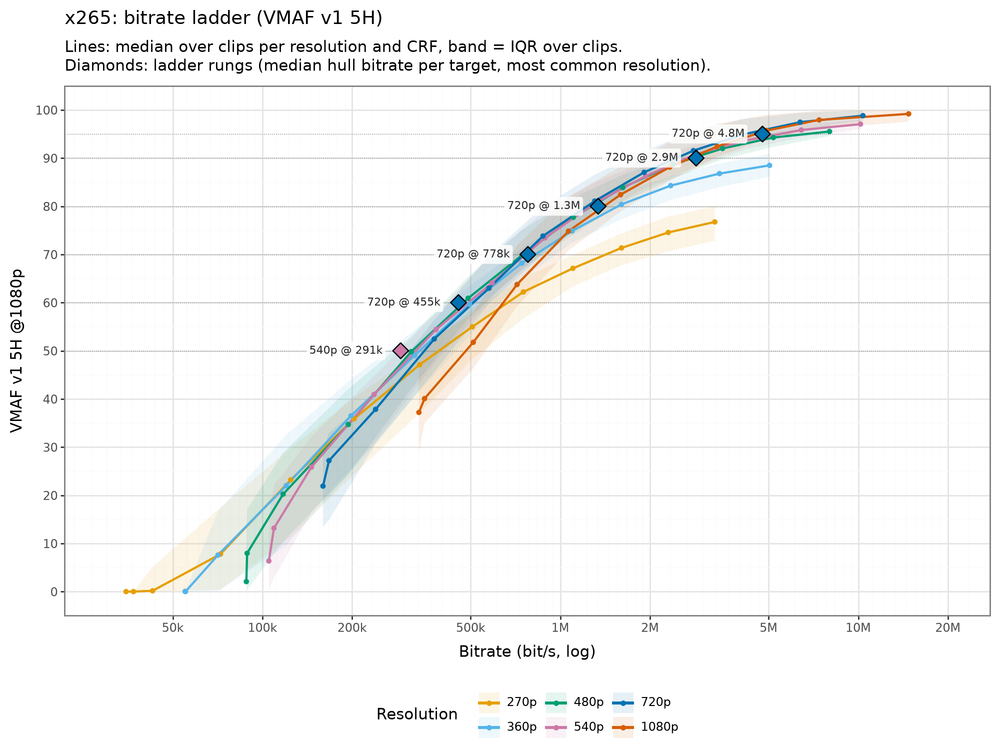
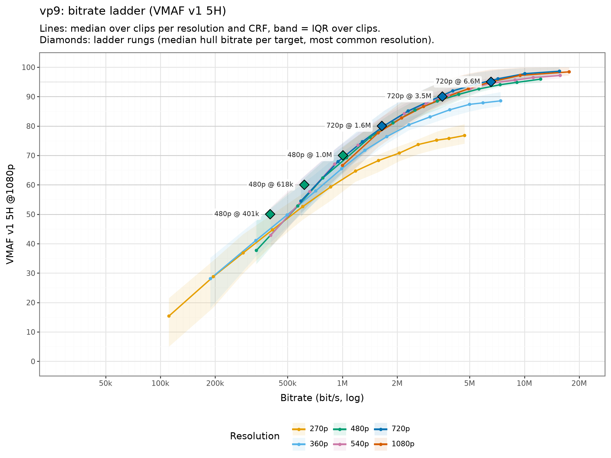
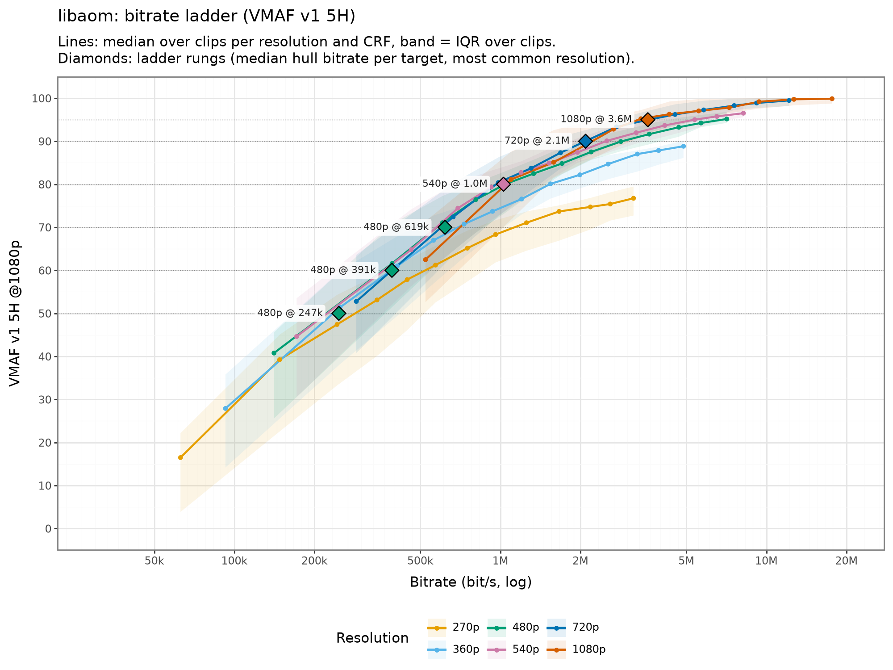
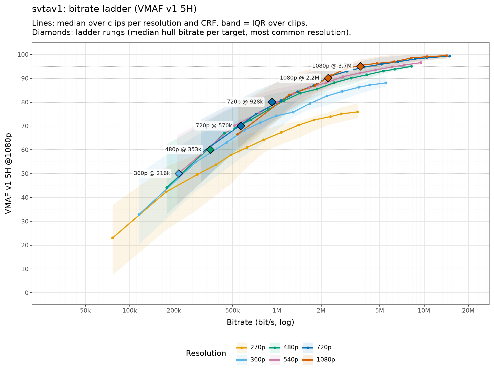

# AOM CTC Dynamic Optimizer Grid

**Author:** Werner Robitza

This repo creates per-title bitrate ladders for the `a2_2k` clips of the [AOM CTC test set](https://media.xiph.org/video/aomctc/test_set/). We need the ladders for the ABR simulation in the VQEG CAP/CSP Collaboration pilot work, which uses the [SFV reference player](https://github.com/micseu/SFV-Reference-Implementation).

The approach follows Netflix's [Dynamic Optimizer](https://netflixtechblog.com/dynamic-optimizer-a-perceptual-video-encoding-optimization-framework-e19f1e3a277f):

1. We pick a set of clips (SRCs) and codecs/resolutions/CRF values (“Grid”).
2. For each clip, we encode every combination of codec, resolution and CRF, and measure the quality of each encode with VMAF.
3. This gives us a comparison of bitrate vs. quality for each clip/codec/resolution tuple.
4. We then keep only the best encodes (the convex hull) and pick the ones that reach VMAF 95, 90, 80, 70, 60 and 50.

This way, every codec gets a ladder with the same quality steps, at least according to VMAF. Across clips, we report medians.

>[!NOTE]
> Using the same CRF for all codecs would not work, because CRF means something different in each encoder. For example, x264 at CRF 23 does not look like x265 at CRF 23.

## How it works

### Test set

We use the 22 clips of [`a2_2k`](https://media.xiph.org/video/aomctc/test_set/a2_2k/). They are 1920×1080, except two vertical clips at 1080×1920. Some are 8-bit and some 10-bit, all 4:2:0, with 25 to 60 fps. Each clip is only 130 frames long, so about 2 to 5 seconds.

### Encoding grid

All encodes are 8-bit 4:2:0, with a keyframe about every 2 seconds. We scale down with `lanczos` to 1080, 720, 540, 480, 360 and 270p (for vertical clips, that is the width, not the height).

| Codec    | Encoder    | Settings                                      | CRF values              |
| -------- | ---------- | --------------------------------------------- | ----------------------- |
| `x264`   | libx264    | `-preset slow`                                | 15 to 51, in steps of 3 |
| `x265`   | libx265    | `-preset slow`                                | 15 to 51, in steps of 3 |
| `vp9`    | libvpx-vp9 | `-deadline good -cpu-used 2 -b:v 0 -row-mt 1` | 15 to 63, in steps of 4 |
| `libaom` | libaom-av1 | `-cpu-used 4 -b:v 0 -row-mt 1`                | 15 to 63, in steps of 4 |
| `svtav1` | libsvtav1  | `-preset 4`                                   | 15 to 63, in steps of 4 |

That gives 22 clips × 5 codecs × 6 resolutions × 13 CRF values = 8,580 encodes.

### Metrics

The exact encoder calls, as built by `scripts/run_grid.py`, are below. `<keyint>` is double the frame rate, rounded, and `<tiles>` is 1 for 720p and above, 0 below. Vertical clips use `scale=<res>:-2` instead of `scale=-2:<res>`.

```bash
# common part
ffmpeg -i <src>.y4m -vf scale=-2:<res>:flags=lanczos,format=yuv420p -an <codec args> out.mkv

# x264
-c:v libx264 -preset slow -crf <crf> -g <keyint> -keyint_min <keyint> -x264-params threads=4
# x265
-c:v libx265 -preset slow -crf <crf> -x265-params keyint=<keyint>:min-keyint=<keyint>:pools=4:frame-threads=2
# VP9
-c:v libvpx-vp9 -deadline good -cpu-used 2 -crf <crf> -b:v 0 -row-mt 1 -tile-columns <tiles> -g <keyint> -threads 4
# libaom
-c:v libaom-av1 -cpu-used 4 -crf <crf> -b:v 0 -row-mt 1 -tile-columns <tiles> -g <keyint> -threads 4
# SVT-AV1
-c:v libsvtav1 -preset 4 -crf <crf> -g <keyint> -svtav1-params lp=4
```

We used ffmpeg 9.0.2 for the encoding.

For quality analysis, we use [ffmpeg-quality-metrics](https://github.com/slhck/ffmpeg-quality-metrics) to compare each encode with the original clip. The encode is first scaled up to 1080p (bicubic), since we assume a 1080p display. We use the VMAF v1.0.16 models with `--vmaf-10bit`, and each encode is measured twice:

- with `vmaf_v1.0.16_3d0h` (viewing distance 3H, the counterpart of the v0.6.1 default model), plus PSNR and SSIM
- with `vmaf_v1.0.16_5d0h` (viewing distance 5H, the counterpart of the v0.6.1 phone model), which we use for the ladders

For clips with 50 fps or more, we use the high frame rate variants (`vmaf_v1.0.16_hfr_3d0h` and `vmaf_v1.0.16_hfr_5d0h`). The score of an encode is the mean over all frames.

### How the ladders are built

The script `scripts/analyze.py` does this for each clip and codec, once with VMAF 5H and once with VMAF 3H:

- It puts all 78 encodes (6 resolutions × 13 CRF values) into one pool, regardless of resolution, and drops every encode for which a cheaper encode is at least as good (i.e., a pareto optimization). From the rest, it builds the upper convex hull, with bitrate on a linear scale. So the switch points between resolutions come out of the data.
- For each VMAF target, it reads the bitrate off the hull, interpolating between points (`bitrate_interp_kbps`).
- It also picks the cheapest real encode on the hull that reaches the target, and notes its resolution, CRF and bitrate (`sel_res`, `sel_crf`, `sel_bitrate_kbps`).
- It marks each target as `ok`, `below_grid` (even the cheapest encode is above the target) or `unreachable` (no encode reaches it).

Only then does it aggregate across clips, with medians. (Taking the median over clips per resolution first and building the hull afterwards would give a different, less meaningful curve.)

The edge cases (targets marked `below_grid` or `unreachable`) are listed in `results/ladder_status.csv`.

## Results

Below is one table per codec, for VMAF 5H. Bitrates are the median over all clips, read off each clip's convex hull. The IQR column gives the 25th to 75th percentile. Resolution and CRF are those of the real hull encodes that reach the target. Each plot shows one rate–quality curve per resolution (median over clips at each CRF, with the interquartile range of VMAF as a band) and the ladder rungs from the table as diamonds, colored by their most common resolution.

The exact ladder encodes for each clip are in `results/ladder_points_<codec>.csv`.

> [!WARNING]
> Tables still tbd., the run is ongoing.

<!-- tables:start -->

### x264

| VMAF 5H | Median kbit/s | IQR kbit/s | Most common resolution | Median CRF | Clips |
| ------- | ------------- | ---------- | ---------------------- | ---------- | ----- |
| 95 | 6327 | 4474–12639 | 720p | 21 | 22 |
| 90 | 3513 | 1991–7452 | 720p | 24 | 22 |
| 80 | 1682 | 883–2151 | 480p | 27 | 22 |
| 70 | 1008 | 544–1388 | 480p | 30 | 22 |
| 60 | 649 | 384–964 | 480p | 33 | 22 |
| 50 | 438 | 276–721 | 360p | 33 | 22 |



### x265

| VMAF 5H | Median kbit/s | IQR kbit/s | Most common resolution | Median CRF | Clips |
| ------- | ------------- | ---------- | ---------------------- | ---------- | ----- |
| 95 | 4770 | 3449–10357 | 720p | 24 | 21 |
| 90 | 2856 | 1437–5507 | 720p | 28 | 22 |
| 80 | 1339 | 646–1918 | 720p | 33 | 22 |
| 70 | 778 | 400–1209 | 720p | 36 | 22 |
| 60 | 455 | 264–873 | 720p | 39 | 22 |
| 50 | 291 | 181–645 | 540p | 39 | 22 |



### VP9

| VMAF 5H | Median kbit/s | IQR kbit/s | Most common resolution | Median CRF | Clips |
| ------- | ------------- | ---------- | ---------------------- | ---------- | ----- |
| 95 | 6556 | 4751–11665 | 720p | 31 | 21 |
| 90 | 3542 | 1674–7672 | 720p | 39 | 22 |
| 80 | 1648 | 747–2322 | 720p | 47 | 22 |
| 70 | 1007 | 450–1459 | 480p | 51 | 22 |
| 60 | 618 | 306–1017 | 480p | 55 | 22 |
| 50 | 401 | 218–736 | 480p | 59 | 22 |



### libaom (AV1)

| VMAF 5H | Median kbit/s | IQR kbit/s | Most common resolution | Median CRF | Clips |
| ------- | ------------- | ---------- | ---------------------- | ---------- | ----- |
| 95 | 3583 | 1955–7631 | 1080p | 35 | 20 |
| 90 | 2090 | 1027–3592 | 720p | 43 | 21 |
| 80 | 1027 | 465–1644 | 540p | 51 | 22 |
| 70 | 619 | 282–982 | 480p | 55 | 22 |
| 60 | 391 | 191–663 | 480p | 59 | 22 |
| 50 | 247 | 128–508 | 480p | 59 | 22 |



### SVT-AV1

| VMAF 5H | Median kbit/s | IQR kbit/s | Most common resolution | Median CRF | Clips |
| ------- | ------------- | ---------- | ---------------------- | ---------- | ----- |
| 95 | 3701 | 2118–8264 | 1080p | 43 | 20 |
| 90 | 2233 | 1072–6174 | 1080p | 45 | 22 |
| 80 | 928 | 442–1624 | 720p | 55 | 22 |
| 70 | 570 | 263–921 | 720p | 59 | 22 |
| 60 | 353 | 168–597 | 480p | 59 | 22 |
| 50 | 216 | 117–408 | 360p | 63 | 22 |



<!-- tables:end -->

## Usage

### Requirements

You only need `uv` installed; the scripts are [uv inline scripts](https://docs.astral.sh/uv/guides/scripts/), so uv installs their dependencies.

You need `ffmpeg` with libvmaf and all five encoders, and `ffmpeg-quality-metrics` on your `PATH` (`uv tool install ffmpeg-quality-metrics`).

Download the [`a2_2k` clips](https://media.xiph.org/video/aomctc/test_set/a2_2k/). Then copy `.env.example` to `.env` and set the two paths:

- `DYNOPT_ROOT`: the working directory for sources, encodes, results and logs (a fast disk helps)
- `DYNOPT_SRC_DIR`: the directory with the downloaded clips

Variables set in the environment override `.env`.

### Running the scripts

```bash
scripts/setup_sources.sh                    # copy the clips from $DYNOPT_SRC_DIR to $DYNOPT_ROOT/src
uv run --script scripts/run_grid.py -j 8    # encode and measure, 8 jobs with 4 threads each
uv run --script scripts/analyze.py          # build the hulls and ladders
scripts/collect_results.sh                  # copy the CSVs into results/
uv run --script scripts/plots.py            # draw the plots into results/plots
uv run --script scripts/readme_tables.py    # write the tables into this README
```

`run_grid.py` is idempotent; if it is interrupted, it can be started again.

For quick tests, you can limit it with `--clips`, `--codecs`, `--res` and `--crfs`.

## Outputs

The encodes and per-encode results are too large for this repo (about 20 GB), so they stay in `$DYNOPT_ROOT`:

- `encodes/<codec>/<clip>/<res>p_crf<N>.mkv`: the encoded videos
- `results/<codec>/<clip>/<res>p_crf<N>.json`: bitrate, VMAF 3H, VMAF 5H, PSNR, SSIM and timings for each encode, with per-frame scores in `.frames.json.gz`
- `logs/`: logs of the run and the analysis

The `results/` folder of this repo has the analysis:

- `all_encodes.csv`: every encode in the grid, with resolution, CRF, bitrate, VMAF 3H/5H, PSNR and SSIM
- `hull_points.csv`: the encodes on the convex hull, per clip, codec and metric
- `ladder_per_title.csv`: the ladder for each clip, codec, metric and VMAF target
- `ladder_points_<codec>.csv`: the ladder encodes for VMAF 5H, one file per codec, with resolution, CRF, keyframe interval, bitrate and scores
- `ladder_per_codec.csv`: medians, quartiles, most common resolution and median CRF per codec and target (the source of the tables above)
- `ladder_summary.csv` and `median_bitrate_5h.csv` / `median_bitrate_3h.csv`: median bitrate per codec and target
- `ladder_resolution_distribution.csv`: which resolutions the ladders pick
- `ladder_status.csv`: which targets are `ok`, `below_grid` or `unreachable`
- `run_grid.log`: the log of the full run

The plots are in `results/plots/`. Most come in two versions, `_5h` and `_3h`, one for each VMAF model:

- `ladder_<codec>_*.png`: rate–quality curves per resolution for one codec, with its ladder rungs
- `ladder_bitrate_*.png`: bitrate needed for each VMAF target and codec (median and interquartile range)
- `savings_vs_x264_*.png`: bitrate change compared to x264 at the same VMAF, per clip
- `ladder_resolutions_*.png`: which resolution the ladder picks for each target
- `hulls_all_clips_*.png`: the convex hull for each clip and codec
- `vmaf_vs_crf_1080p.png`: VMAF against CRF at 1080p, which shows that CRF values don't match between encoders
- `example_grid_Aerial3200.png`: all resolution and CRF combinations for one clip, with its hull

## Limitations

- The clips are very short (130 frames). For realistic ABR tests with several segments, we need longer source videos, such as the [long versions](https://media.xiph.org/video/aomctc/test_set_long/a2_2k/) of the same clips (5 to 19 seconds).
- All encodes use a fixed keyframe interval of about 2 seconds.
- We only computed scores for a 1080p display. For a 4K display, we would need the 4K VMAF model and a grid based on the `a1_4k` clips.

## License

Copyright (c) 2026 Werner Robitza

Permission is hereby granted, free of charge, to any person obtaining a copy of this software and associated documentation files (the “Software”), to deal in the Software without restriction, including without limitation the rights to use, copy, modify, merge, publish, distribute, sublicense, and/or sell copies of the Software, and to permit persons to whom the Software is furnished to do so, subject to the following conditions:

The above copyright notice and this permission notice shall be included in all copies or substantial portions of the Software.

THE SOFTWARE IS PROVIDED “AS IS”, WITHOUT WARRANTY OF ANY KIND, EXPRESS OR IMPLIED, INCLUDING BUT NOT LIMITED TO THE WARRANTIES OF MERCHANTABILITY, FITNESS FOR A PARTICULAR PURPOSE AND NONINFRINGEMENT. IN NO EVENT SHALL THE AUTHORS OR COPYRIGHT HOLDERS BE LIABLE FOR ANY CLAIM, DAMAGES OR OTHER LIABILITY, WHETHER IN AN ACTION OF CONTRACT, TORT OR OTHERWISE, ARISING FROM, OUT OF OR IN CONNECTION WITH THE SOFTWARE OR THE USE OR OTHER DEALINGS IN THE SOFTWARE.
